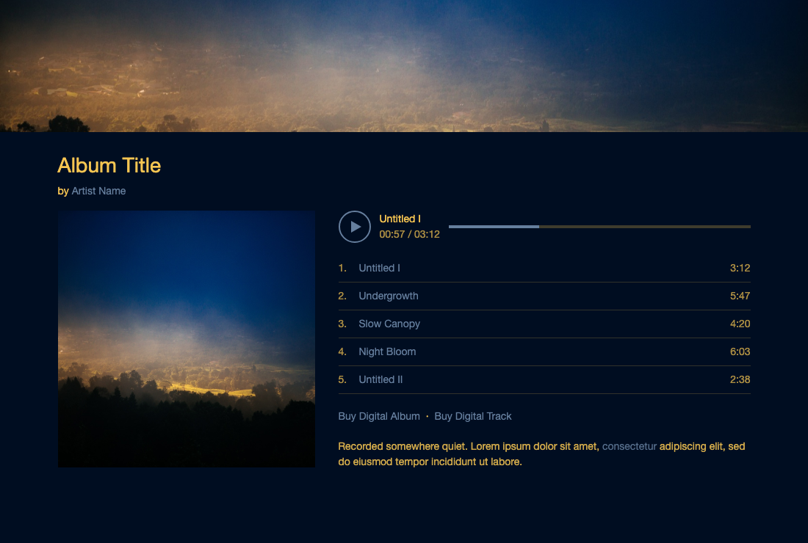
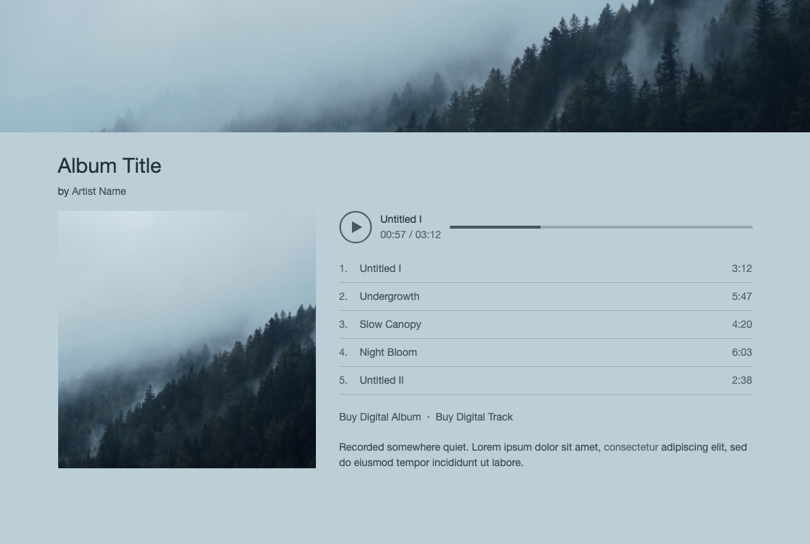

# bandcamp-palette

Extracts the main colors of an image and suggests three colors for a Bandcamp page: **background**, **text** and **link**. It uses [`extract-colors`](https://www.npmjs.com/package/extract-colors) for the extraction and [`get-pixels`](https://www.npmjs.com/package/get-pixels) to read the image (JPG, PNG, GIF).

## Setup

```sh
git clone git@github.com:josephlarralde/bandcamp-palette.git bandcamp-palette
cd bandcamp-palette
npm install
```

Requires Node 18+ (ES modules). Once the package is published or installed globally (`npm i -g .`), it can also be run as `bandcamp-palette <image>`, or with `npx` from a checkout: `npx . <image>`.

## Usage

```sh
node palette.js <image> [--tint] [--json] [--preview[=file.html]]
```

| Option | Effect |
|---|---|
| *(none)* | Prints the three Bandcamp colors with terminal swatches and contrast ratios, then the top 12 palette colors by area. |
| `--tint` | Uses a finer extraction and picks a *tinted* background instead of pure black/white (see below). |
| `--preview[=file.html]` | Writes a self-contained HTML mockup of a Bandcamp album page (default `preview.html`) using the suggested colors, with your image as banner and cover art. Open it in a browser. Combines with `--tint`. |
| `--json` | Prints JSON with the Bandcamp colors, their contrast ratios and the full palette (hex + area in %). |

Example:

```sh
node palette.js example/storm.jpg --tint
```
```
Bandcamp
  background #000d21
  text       #f6c552  (contrast 12.07:1)
  link       #667f9e  (contrast 4.73:1)
```

Then in Bandcamp's page design panel, set the background, text and link colors to these values.

### Examples

#### Dark image

[`example/storm.jpg`](example/storm.jpg) is a dark stormy sky over a golden valley. Without `--tint` the background is near-black; with it, the deep blue of the sky is picked up.

| | Default | `--tint` |
|---|---|---|
| Background | `#000202` | `#000d21` |
| Text | `#d0a241` | `#f6c552` |
| Link | `#647d9b` | `#667f9e` |

The full default output is in [`example/storm.json`](example/storm.json). The preview below uses the `--tint` colors (`node palette.js example/storm.jpg --tint --preview`):



Image: ["Countryside under a dark cloud"](https://commons.wikimedia.org/wiki/File:Countryside_under_a_dark_cloud_(Unsplash).jpg) by Anton Repponen, released under [CC0 1.0](https://creativecommons.org/publicdomain/zero/1.0/) (public domain dedication). Resized to 1600 px wide.

#### Light image

[`example/mist.jpg`](example/mist.jpg) is a misty forest, mostly light grey-blue. The light background gets dark text and links.

| | Default | `--tint` |
|---|---|---|
| Background | `#bccfd7` | `#bccfd7` |
| Text | `#23303a` | `#0b141d` |
| Link | `#485762` | `#354550` |



Image: ["Mist over a dark forest"](https://commons.wikimedia.org/wiki/File:Mist_over_a_dark_forest_(Unsplash).jpg) by Paul Gilmore, released under [CC0 1.0](https://creativecommons.org/publicdomain/zero/1.0/) (public domain dedication). Resized to 1600 px wide.

## How the colors are attributed

1. **Extraction.** `extract-colors` clusters the pixels (60,000 sampled) into a palette. Each color has a hex value, an `area` (share of the image) and a `saturation`. By default similar shades are merged (`distance: 0.15`).
2. **Background.** The color with the largest area. If its luminance is below 0.4 the image is treated as *dark*, otherwise as *light*. This decides which way text and links are pushed below.
3. **Text.** Among the other palette colors, the one with the highest contrast against the background. If it is below **7:1** (WCAG AAA for body text), it is blended toward white (dark image) or black (light image) until it reaches 7:1.
4. **Link.** Candidates are the other palette colors, ranked by saturation weighted by area: first those that already reach **4.5:1** (WCAG AA), then the remaining ones lightened or darkened until they reach 4.5:1. The first candidate with a clearly different hue from the text (≥ 40° apart, saturation ≥ 0.25) wins. If there is none, the first one that is at least visibly different from the text (RGB distance ≥ 45), and failing that, the first candidate.
5. **Separation.** The link should stay less prominent than the text: the text's contrast must be at least **1.8×** the link's. If it isn't, the link is first dimmed toward the background (never below 4.5:1), then the text is pushed toward black or white until the gap is reached. Palettes that already have enough gap are left untouched.

Contrast is the WCAG relative-luminance ratio, so text and link legibility on the background is guaranteed.

### `--tint`

Large flat areas are often pure black or white, which hides the tinted shades (a very dark brown, a pale blue-grey) near them. With `--tint`:

- extraction uses much smaller merge distances (`distance 0.04`, `lightnessDistance 0.02`, `saturationDistance 0.1`), so close shades stay separate;
- the background becomes the **darkest** (dark image) or **lightest** (light image) color that has saturation ≥ 0.15 and covers at least 0.5% of the image, instead of the dominant color;
- text and link are attributed as above, against this new background.

If no color qualifies, it falls back to the dominant color.

## Light images

The same logic works on light images: the dominant color (white, cream…) becomes the background, and text and link are darker colors from the palette, darkened if needed to meet the contrast targets. See the light-image example above.

## Limits

- Text and link are always taken from the image (adjusted for contrast), so an image with very few colors can give a text color that is a near-black or near-white tint rather than a distinctive hue.
- On near-monochrome images (like the misty forest) text and link end up close to each other, because the palette has no second hue to choose from. A different hue is preferred for the link when the palette has one, but it is not guaranteed; the separation step at least keeps them apart in lightness.
- Very small palette areas (rounded to `0%`) can still be picked as text; that is intended, since accents are often rare.

## License

MIT for the code (see [LICENSE](LICENSE)). The example images in `example/` are CC0 (public domain); credits are in the Examples section.
